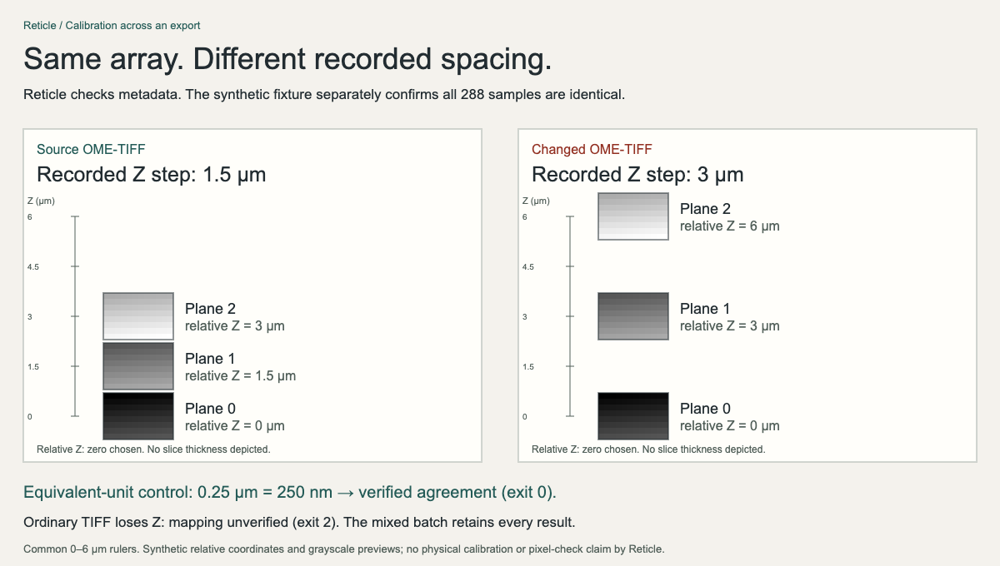

# Reticle

**The pixels can stay. The calibration can change.**

Reticle compares recorded microscopy TIFF calibration before and after export. It checks supported plane mappings, normalizes units and retains exact input identities in JSON receipts. It reads metadata, not specimen pixels or instrument accuracy.

<picture>
  <source media="(max-width: 600px)" srcset="docs/presentation/spacing-mobile.png">
  
</picture>

**Same samples, different recorded spacing.** In the new [completed installed-CLI run](docs/presentation/README.md), source and changed export share all 288 synthetic samples. Their declared Z steps differ, so Reticle exits **1**. The separate `0.25 µm → 250 nm` control agrees and exits **0**. An ordinary TIFF loses Z information and has unverified plane mapping; the mixed batch retains all three results and exits **2**.

[Reopen the complete worked example](docs/presentation/worked-example.zip) · [Actual native HTML report](docs/presentation/comparison.html) · [JSON receipt](docs/presentation/comparison.json) · [Units, ruler and recheck details](docs/presentation/README.md)

A fresh receipt recheck detects changed input bytes even when metadata still agrees. This binds an inspected snapshot; it does not prove physical calibration or pixel equality. Saved HTML is a local report, so GitHub displays its source. Download and extract the worked example to open it.

The [original 0.1.0 report](docs/synthetic-comparison.html) and [capture](docs/synthetic-comparison.png) remain historical and unchanged. Current source is `0.1.1.dev0`; the existing setup, series selection, batch and recheck routes follow.

## Run

Python 3.12 or later. This checkout is `0.1.1.dev0`; the [v0.1.0 release](https://github.com/nazeeh111/Reticle/releases/tag/v0.1.0) remains a historical snapshot without source-bound recheck receipts.

```sh
git clone https://github.com/nazeeh111/Reticle.git
cd Reticle
python -m venv .venv
. .venv/bin/activate
python -m pip install .
python examples/make_fixtures.py
reticle examples/source.ome.tif examples/changed.ome.tif
# Exit 1: recorded Z spacing changed.
reticle examples/source.ome.tif examples/unit-equivalent.ome.tif --format html --output unit-equivalent.html
# Exit 0: 0.25 µm and 250 nm describe the same X spacing.
```

Run the commands separately if your shell stops on a nonzero exit. The synthetic fixture generator writes only to `examples/` and refuses to replace an existing generated fixture. The changed export has identical pixels and doubles the recorded Z spacing from 1.5 to 3 µm. The equivalent export records X spacing as 250 nm instead of 0.25 µm. Open `unit-equivalent.html` in a browser; it contains no image pixels, scripts or remote assets. The three-pair example below writes a separate `comparison.html` report.

Exit codes: `0` means required calibration values agree and the supported plane mapping was checked; `1` means a calibration or dimension difference, or missing required calibration; `2` means a file, mapping or input could not be checked. Agreement does not prove instrument accuracy or pixel equality.

## Reproduce the shown report

After generating the fixtures above, compare the three existing pairs:

```sh
reticle --manifest examples/pairs.json --format html --output comparison.html
```

Open `comparison.html` locally. This demonstration exits **2** because the ordinary TIFF pair has unverified plane mapping; its other two results remain in the report. Reusing an existing report path is refused. Choose a new filename to generate another report. The saved example contains no image pixels, JavaScript or remote assets.

## Select the image series

A multi-series file requires an explicit zero-based index. Reticle does not pair images by similar names or assume that matching OME IDs prove their identity.

```sh
reticle source.ome.tif exported.ome.tif --source-series 1 --export-series 0
```

For batch work, provide explicit pairs in a JSON manifest. Paths are relative to the manifest:

```json
[
  {"source": "raw/sample-a.ome.tif", "export": "export/sample-a.ome.tif"},
  {"source": "raw/series.ome.tif", "export": "export/series.ome.tif", "source_series": 1, "export_series": 0}
]
```

```sh
reticle --manifest pairs.json --format json --output calibration.json
```

Reports never overwrite existing files or input paths. A failed pair is included in the report and does not suppress results from other pairs.
Each pair has a verdict: verified agreement, differences found, or agreement cannot be established. Display names keep manifest-relative paths so equally named files remain distinguishable. JSON receipts also contain resolved absolute input paths; treat them as potentially sensitive.

## What is checked

- Spatial calibration values, normalized to micrometres with their original value, unit and metadata source retained.
- Recorded X/Y/Z/C/T dimensions where available.
- Supported single-file scalar OME-TIFF plane mappings, so metadata is not silently attached to the wrong image series.
- A supported OME scalar numeric pixel type matching each mapped TIFF plane's declared type.
- Ordinary scalar TIFF X/Y resolution declarations. These are labeled as TIFF resolution rather than independently measured microscope calibration.

Missing calibration is never assumed to be 1 µm/pixel. Z spacing is optional when both selected images are known to have one Z plane and neither declares Z calibration. Unsupported layouts and metadata are reported as unverified, not quietly accepted.

Reticle is a metadata comparison, not a pixel comparison, image registration tool, calibration procedure, or full OME schema validator. It does not establish acquisition quality, instrument accuracy or scientific validity. See [design and scope](docs/design.md).

## Development

```sh
python -m unittest discover -s tests -v
```

Synthetic fixtures test metadata changes independently of pixel content. No private microscopy data is included.
For a release check, build a wheel with `python -m pip wheel --no-deps --wheel-dir dist .`, install it in a fresh virtual environment, and run its `reticle` command from outside this checkout with `PYTHONPATH` unset. Run `python scripts/verify_workflow.py` against the generated examples and check both batch reports and output-file refusal. Local check results and remaining limits belong in the release evidence; a local pass does not stand in for a live CI run.

## License

Reticle is [MIT licensed](LICENSE). Its TIFF reader, [tifffile](https://github.com/cgohlke/tifffile), and XML parser, [defusedxml](https://github.com/tiran/defusedxml), retain their own licenses.

### Rechecking a saved JSON report

JSON reports include a versioned policy, each selected series, and SHA-256 and byte length for the exact source and export snapshots inspected. The receipt records absolute input paths; treat reports as potentially sensitive. Run `reticle --recheck calibration.json` from any directory to re-inspect those paths and require the same bytes, selections, policy and comparison. A mismatch, incomplete report, report from another Reticle version, or unreadable input exits 2; a matching report retains its original aggregate status. Only recheck trusted reports: their paths identify files that will be read. Text and HTML are presentation formats and are not replay receipts.

For byte identity, Reticle copies and hashes each entire input before inspecting its metadata; it does not decode pixels. Each input is limited to 1 GiB, and temporary storage must hold one full input during inspection. A file edited during copying can produce a mixed snapshot: the receipt binds the bytes actually inspected, not a claim that the snapshot existed as an atomic source generation. A later file change is detected on recheck; no protection is claimed against edits after a successful recheck. These checks do not establish pixel equality or physical calibration.

Image and recheck-receipt inputs must be regular files. Reticle opens and checks the actual file descriptor without waiting on pipes, checks the declared file size before reading, and enforces the size limit while reading as well. This admission depends on operating-system nonblocking file-open support; platforms without it refuse the operation. Recheck compares JSON value types as well as values, so changing a boolean to a number does not preserve a receipt.
